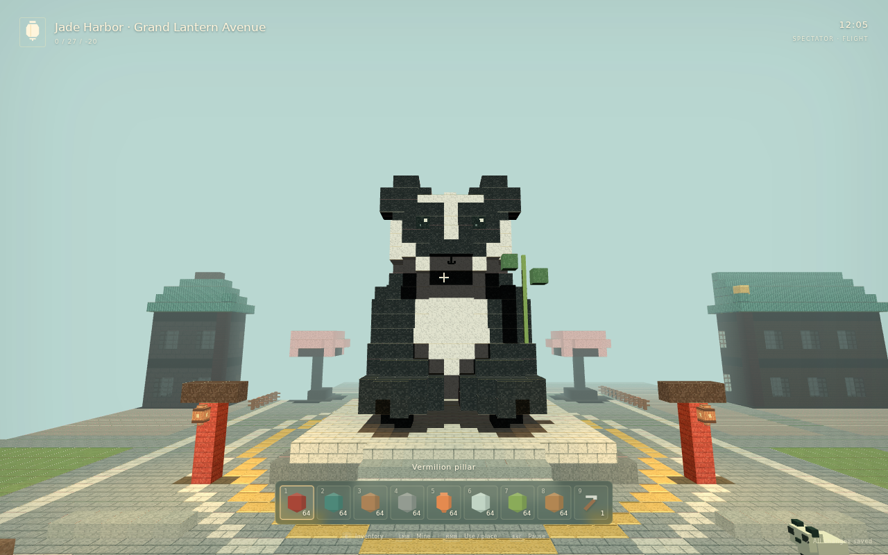

# Jade Harbor

**Build Beyond Boundaries.**

Jade Harbor is a **Minecraft-inspired browser voxel sandbox** that reimagines the familiar building and survival formula around a procedural Chinatown city. The public `v1.0.0` release is a single-player portfolio build centered on an editable city, Panda Plaza, exploration, building, survival systems, local persistence, NPCs, crafting, and a compact automation layer.

**Release:** `v1.0.0`  
**Platform:** modern desktop browsers with WebGL2  
**Stack:** TypeScript, Three.js, Vite, IndexedDB  
**License:** MIT



## Why I built it

Jade Harbor is a portfolio project about **AI-assisted software engineering under human product direction**. I wanted to test whether a playable voxel prototype could be pushed into a distinctive, testable product through repeated design decisions, manual playtesting, bug reproduction, regression testing, and release discipline instead of treating generated code as automatically correct.

The project uses the Minecraft-style voxel sandbox as a familiar foundation, then pushes it toward a **city-first Chinatown sandbox** with its own procedural generation, visual identity, landmarks, NPC roles, themed stations, and supporting gameplay systems. Its biggest departure is the world-generation philosophy: instead of a wilderness-first sandbox, Jade Harbor is built around a dense, procedural, editable Chinatown city as the primary playable world.

**Minecraft notice:** Jade Harbor is an independent project. **NOT AN OFFICIAL MINECRAFT PRODUCT. NOT APPROVED BY OR ASSOCIATED WITH MOJANG OR MICROSOFT.** Minecraft is a trademark of Microsoft. Jade Harbor does **not** use Minecraft source code or game assets.

## My role in the project

I acted as the **product owner, creative director, QA lead, and engineering operator**.

My responsibilities were to:

- define the Chinatown-first product direction and protect the visual identity;
- choose the scope, acceptance criteria, controls, and UX expectations;
- manually playtest important builds and report interaction failures;
- direct AI coding agents through implementation, debugging, refactoring, and test creation;
- reject experiments that weakened an accepted baseline instead of keeping changes only because they were new;
- require reproducible evidence for bug fixes, persistence rules, resource conservation, and production-build integrity;
- decide where to stop feature expansion and turn the project into a clean public release.

AI tools contributed substantial implementation and analysis work. Human review, product decisions, acceptance testing, and repeated requests for deeper audits were part of the engineering process rather than an afterthought.

## Engineering evolution and reliability

Jade Harbor evolved through repeated implementation, playtesting, refactoring, regression testing, and reliability work rather than a single build-and-polish cycle.

The project began as a functional browser voxel sandbox with deterministic terrain, chunk generation, first-person movement, mining, building, inventory, local state, and a TypeScript/Three.js rendering foundation. From there, the generic world-generation model was transformed into the current **city-first procedural Chinatown**, including dense districts, streets, markets, riverside areas, a jade-and-terracotta architectural language, and Panda Plaza.

As the project grew, engineering work increasingly focused on preserving correctness across connected systems:

- **World and engine architecture:** evolved deterministic voxel generation into a dense editable urban world while preserving chunk streaming and bounded simulation behavior.
- **Rendering and performance:** reduced unnecessary meshing, dirty-section work, empty GPU nodes, and avoidable lighting invalidation exposed by dense city geometry.
- **Player interaction and game modes:** stabilized the first-person viewmodel, pointer lock, spawning, movement, collision, and explicit Survival/Creative/Spectator permissions and state transitions.
- **Inventory and gameplay transactions:** audited crafting, smelting, brewing, equipment, trading, containers, drops, repair, buckets, and item consumption for atomicity and resource conservation.
- **Simulation and entities:** hardened update ordering, entity lifecycles, combat, fluids, falling blocks, automation, NPC interactions, and environmental edge cases.
- **Persistence:** strengthened IndexedDB save/load reconstruction, validation, revision handling, canonical state representation, and rejection of malformed or pathological persisted values.
- **Cross-system integration:** tested complete gameplay flows spanning world edits, inventory, machines, entities, effects, NPCs, drops, and persistence instead of validating each subsystem only in isolation.
- **Adversarial validation:** repeatedly exercised already-passing systems using corrupted saves, full-capacity transactions, lazy state creation, extreme numeric values, authority leaks, and lifecycle-order failures.
- **Testing and release engineering:** converted reproduced failures into regressions for deterministic generation, state conservation, mode permissions, malformed saves, production-build integrity, archive integrity, and release reproducibility.
- **Code and UI maintainability:** later maintenance removed duplicated/dead styling and code, simplified UI construction and event handling, tightened TypeScript correctness, and kept production output aligned with canonical source.

A recurring principle throughout development was that an accepted baseline became a contract: newer implementations were not kept simply because they were newer. Regressions found through manual playtesting, static audits, integration testing, or adversarial review were reproduced, fixed at their source, and, where practical, turned into permanent automated checks.

For the full chronological engineering record, see [`docs/development-history.md`](docs/development-history.md).

## Run locally

Requirements: Node.js 22.12+ and npm.

```bash
npm ci
npm run dev
```

Open the local URL printed by Vite, normally `http://localhost:4173`.

For a production build:

```bash
npm run build
npm run preview
```

For the full release gate, `npm run test:release` performs a fresh production build first and then runs the release/regression checks against that generated output.

The default seed is `jade-harbor`.

## Repository layout

```text
src/          application source
public/       static public assets
dist/         generated production output (ignored on main)
tests/        unit, integration, regression, browser and release checks
docs/         focused project documentation and gameplay proof
scripts/      build, integrity, verification and packaging tools
```

The source is organized by responsibility under `src/core`, `src/game`, `src/persistence`, `src/player`, `src/render`, `src/ui`, and `src/world`.

## Documentation map

Each document has one primary job so the repository stays focused on the released product and its engineering evidence.

| Document | Purpose |
|---|---|
| [`docs/development-history.md`](docs/development-history.md) | The single chronological record of how the project evolved, including major bugs and the fixes that changed the baseline. |
| [`docs/feature-matrix.md`](docs/feature-matrix.md) | Authoritative current release scope and implementation status. |
| [`docs/architecture.md`](docs/architecture.md) | Current engine structure and runtime ownership boundaries. |
| [`docs/gameplay-controls.md`](docs/gameplay-controls.md) | Controls plus concrete examples for interacting with working systems. |
| [`docs/save-schema.md`](docs/save-schema.md) | Persistence model, transaction rules, validation, and save ownership. |
| [`docs/engine-reliability.md`](docs/engine-reliability.md) | Persistence, recovery, world-edit durability, lifecycle and profiling invariants. |
| [`docs/testing-results.md`](docs/testing-results.md) | Executed QA evidence, test commands, and verification boundaries. |
| [`docs/performance.md`](docs/performance.md) | Performance methodology, measured samples, and benchmark cautions. |
| [`docs/known-limitations.md`](docs/known-limitations.md) | Current technical limitations that can affect play or operation. |
| [`docs/branding.md`](docs/branding.md) | Canonical product identity and persistent naming constants. |
| [`docs/proof/README.md`](docs/proof/README.md) | Index and provenance for actual gameplay screenshots. |

## Release verification

The detailed evidence belongs in [`docs/testing-results.md`](docs/testing-results.md). Verification claims are kept separate from product marketing and are limited to checks that have a defined, reproducible command or recorded engineering evidence.

`dist/` is generated locally and ignored on the `main` branch. The static deployment output can be published separately to GitHub Pages (for example, via a `gh-pages` branch).

## License and third-party software

Project code is released under the MIT License; see [`LICENSE`](LICENSE). Third-party notices are in [`THIRD_PARTY_NOTICES.md`](THIRD_PARTY_NOTICES.md) and `docs/licenses/`.
