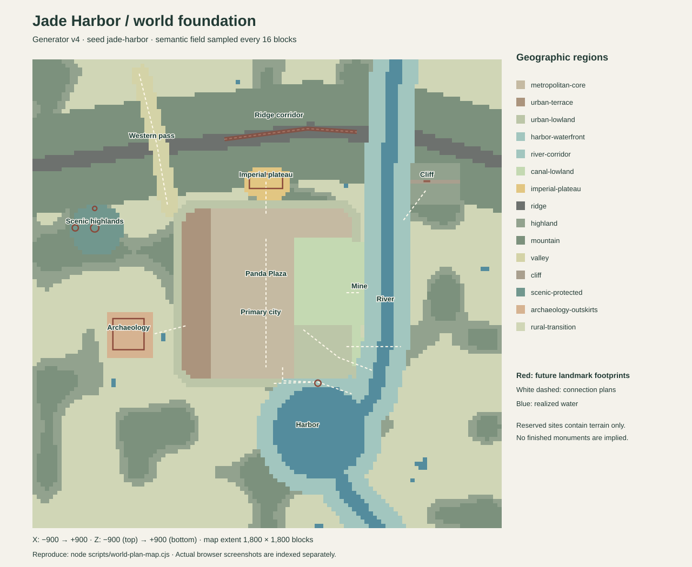
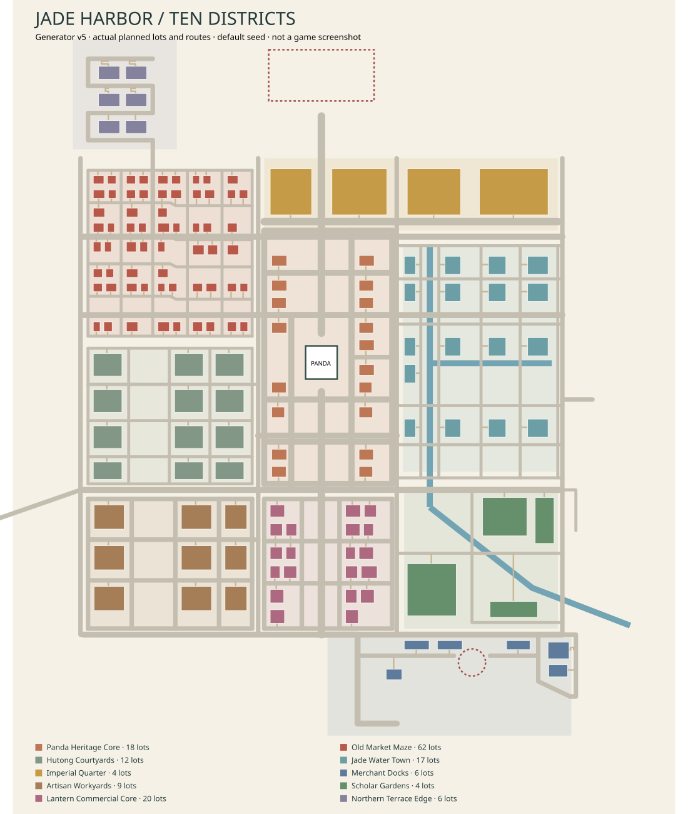

# The world of Jade Harbor

Jade Harbor is built around one continuous Chinatown metropolis, with rivers, harbor space, mountain and ridge corridors, protected landmarks, and five regional destinations around it. The ten city districts define the urban experience; the wider landscape gives those districts a recognizable setting.

## The geography

The world combines:

- a central city organized around Panda Plaza;
- connected streets, markets, courtyards, canals, and waterfronts;
- a harbor and working quay;
- ridge, cliff, mountain, and river corridors;
- eight major landmark destinations;
- five regional villages, landscapes, and garden precincts.

The map has a deliberate city-first balance. The metropolis remains dense, while the surrounding areas use more specific landscape identities such as karst, rocky ridges, tea terraces, orchards, managed gardens, and open scenic paths.

<small>The geographic plan illustrates the original regional layout. It is a planning reference, not a live gameplay screenshot or a complete rendering of the current world.</small>

<small>The district plan illustrates the original road and parcel structure. Later world versions retain the accepted city footprint while adding landmarks, regional destinations, architectural variety, and resident activity.</small>

## Ten city districts

The metropolis is divided into ten districts with different street patterns and roles:

1. **Panda Heritage Core** — the central heritage area around Panda Plaza and the main avenue.
2. **Old Market Maze** — compact market lanes and shopfronts.
3. **Hutong Courtyards** — neighborhood lanes, homes, and shared courtyards.
4. **Jade Water Town** — canals, bridges, and waterside streets.
5. **Imperial Quarter** — ceremonial approaches and the Jade Palace.
6. **Merchant Docks** — harbor access, warehouses, and quay activity.
7. **Artisan Workyards** — workshops and craft-oriented streets.
8. **Scholar Gardens** — gardens, pavilions, and quieter public spaces.
9. **Lantern Commercial Core** — commercial streets and evening activity.
10. **Northern Terrace Edge** — the transition from the city toward ridge and highland routes.

## Landmarks and regional destinations

Eight major landmarks are integrated into the city and its surrounding landscape: Jade Palace, Northern Ridge Wall, Terrace Excavations, Harbor Guild Beacon, Cloudstep Sanctuary, East Cliff Chambers, Reed Moon Garden, and Western Lookout Pagoda.

Five regional destinations extend the variety of the same world: Willow Valley Tulou, Amber Gate Village, Li River Stone Walk, Mist Terrace Tea Village, and Lotus Causeway Gardens.

See [landmarks](landmarks.md) and [regional destinations](regional-destinations.md) for visitor descriptions.

## Landscape and forest balance

Generic wild forest is a small part of the measured world envelope. The current potential mask is four percent, and measured generic-forest coverage remains below five percent. This does not mean every green area is counted as forest: courtyard trees, gardens, orchards, tea planting, and landmark landscaping are distinct uses.

Former woodland and field areas are represented through region-appropriate scenery rather than arbitrary object scatter. The world footprint is not enlarged to make room for these changes.

## Saved-world compatibility

New worlds use generator 10. Existing worlds created with generators 3–9 retain their stored generation identity when loaded. Where supported, **Create updated city copy** creates a separate generator-10 save while leaving the original world and its edits available.

The world plan is deterministic for a given seed and generator version. Player edits are applied over generated terrain and remain authoritative. See [save schema](save-schema.md) for the technical compatibility rules.
